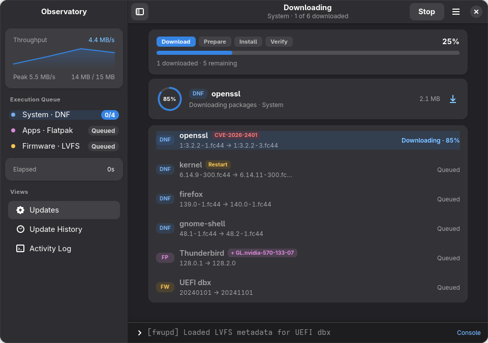
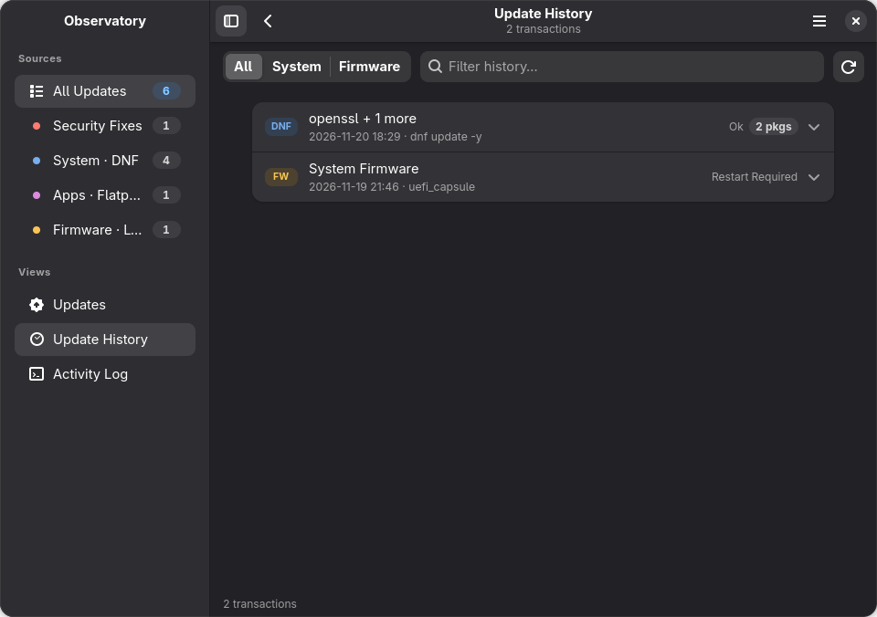
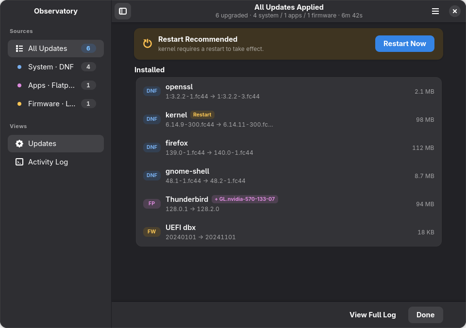

# Fedora Updater

[](https://github.com/rkalla/fedora-updater/actions/workflows/ci.yml)
[](LICENSE)


A fast, transparent GTK4 + Libadwaita desktop updater for Fedora that brings **system (DNF)**, **Flatpak** (user and system, including NVIDIA/runtime extensions), and **LVFS firmware** updates together in a single **Observatory** workspace.

[](screenshots/ready.png)

| Live Telemetry | Update History | Safe Completion |
|:---:|:---:|:---:|
| [](screenshots/running.png) | [](screenshots/history.png) | [](screenshots/done.png) |

---

## Features

- **Unified Fedora update view:** Inspect pending **DNF** packages, **Flatpak** user/system apps and runtime extensions, and **fwupd** LVFS firmware updates in one window with source pills (`DNF` / `FP` / `FW`) and counts.
- **Zero-password checks & history:** Update discovery (`dnf5daemon-server` D-Bus with empty session config, `libflatpak`, and `fwupd`) and transaction history browsing run unprivileged — authentication is only requested when applying privileged updates.
- **Flexible apply modes:** Use per-package checkboxes and the `Update All` SplitButton to choose **Update All**, **Update & Restart**, **Prepare Offline Update**, or **Download Only**.
- **Security advisories & Package Inspector:** Click any update row to inspect version transitions (`old → new`), CVE and Bugzilla references, advisory severity badges, install-size deltas, and summaries.
- **Live telemetry & throughput sparkline:** Watch real-time MB/s download throughput, peak rate, 4-stage pipeline pills (`Download` → `Prepare` → `Install` → `Verify`), and cancel downloads safely mid-run.
- **Hardware & reboot safety guards:** Checks AC power / battery thresholds via `fwupd` before flashing firmware and queries `systemd-logind` shutdown inhibitors before restarting.
- **Observatory dual-mode shell:** Collapsible sidebar (`F9` / `Ctrl+\`), instant package search (`Ctrl+F`), embedded filterable **Activity Log**, **Update History** timeline, and **Fedora release-upgrade** notices.
- **Single portable binary:** Built as one multi-call executable (`fedora-updater` + `fedora-updater --helper`) with zero GSettings schemas required (UI geometry and sidebar state persist in `$XDG_CONFIG_HOME/fedora-updater/ui.json`).

---

## How It Works

Fedora Updater talks to native Fedora platform daemons and libraries by default and automatically falls back to standard CLI tools (run via `--helper` when elevated privileges are needed) if a daemon is unavailable:

| Area | Native Engine (Default) | Automatic Fallback |
|---|---|---|
| **System (DNF)** | `dnf5daemon-server` (`org.rpm.dnf.v0`) D-Bus — zero-auth check & history, advisories, selective/offline/download-only apply | `dnf check-update` / `dnf update -y` via `--helper` |
| **Flatpak** (user & system) | `libflatpak.so.0` discovery (`list_installed_refs_for_update`) & `FlatpakTransaction` with related extensions | `flatpak update --noninteractive` |
| **Firmware** | `fwupd` (`org.freedesktop.fwupd`) D-Bus — battery guards, LVFS release notes, device progress & history | `fwupdmgr refresh` / `get-updates` / `update` via `--helper` |
| **Reboot** | `systemd-logind` (`org.freedesktop.login1`) `CanReboot` / inhibitor check & `Reboot(true)` | `systemctl reboot` |

---

## Build & Run from Source

### Prerequisites (Fedora 42+ / Fedora 44 recommended)

Install the GTK4, Libadwaita, Blueprint, C compiler, and pkg-config development packages:

```bash
sudo dnf install gtk4-devel libadwaita-devel blueprint-compiler gcc pkgconf-pkg-config
```

You also need a Rust toolchain (`cargo` and `rustc`):

```bash
sudo dnf install rust cargo
# Or install via https://rustup.rs/
```

> **Note:** `libflatpak.so.0` and platform daemons are loaded/spoken to at runtime, so `flatpak-devel` is not required to compile.

### Build

Clone the repository and run [`./build`](build):

```bash
git clone https://github.com/rkalla/fedora-updater.git
cd fedora-updater
./build
```

The `./build` script locates `blueprint-compiler` (including `~/.local/bin`), runs `cargo build --release --bin fedora-updater` with LTO + strip enabled, and writes the single standalone binary to `./bin/fedora-updater` (pass `./build --debug` for an unstripped debug build, or invoke `cargo build --release` directly).

### Run or Install

Choose any of the three ways to run:

1. **Run directly (portable, no system changes):**
   ```bash
   ./bin/fedora-updater
   ```
   You can copy `./bin/fedora-updater` anywhere and run it standalone; no companion helper binary is needed.

2. **Install a GNOME Applications menu launcher (user-local):**
   ```bash
   ./install.sh
   ```
   Installs a `.desktop` entry and sized app icons under `~/.local/share/` pointing at `./bin/fedora-updater` so you can launch **Fedora Updater** from GNOME Overview. Remove anytime with `./uninstall.sh`.

3. **Optional system-wide install with Polkit policy:**
   ```bash
   ./scripts/install-helper.sh
   ```
   Installs `/usr/bin/fedora-updater` and `/usr/share/polkit-1/actions/dev.fedora.Updater.policy` (`auth_admin_keep`), keeping privileged `--helper` sessions scoped to one authentication prompt per app session.

---

## Keyboard Shortcuts

| Shortcut | Action |
|---|---|
| `Ctrl+R` or `F5` | Check for updates |
| `Ctrl+F` | Focus package search |
| `F9` or `Ctrl+\` | Toggle Observatory sidebar |

---

## Security & Privilege Model

Fedora Updater ships as a single multi-call binary with strict privilege separation:

```text
fedora-updater           → unprivileged GNOME GUI
fedora-updater --helper  → allowlisted privileged helper (launched via pkexec when needed)
```

1. **Unprivileged D-Bus checks & history:** `dnf5daemon-server` sessions are opened with an empty option map (`SessionManager.open_session({})`), never overriding repo/base config, so checking for updates and viewing history do not trigger Polkit prompts.
2. **Allowlisted helper:** When CLI fallback elevation is required (`pkexec /path/to/fedora-updater --helper`), the GUI spawns a single helper session for the window lifetime. The helper accepts only fixed, hardcoded argv allowlists for `/usr/bin/dnf` and `/usr/bin/fwupdmgr` and never touches user environment overrides.
3. **Polkit policy (`auth_admin_keep`):** [`data/dev.fedora.Updater.policy`](data/dev.fedora.Updater.policy) lets active desktop sessions keep authentication cached across operations in a run without the GUI ever handling passwords.

For local testing without Polkit elevation:

```bash
export FEDORA_UPDATER_HELPER_DIRECT=1   # run --helper without pkexec
# Optional explicit path override (still invokes --helper):
export FEDORA_UPDATER_HELPER=/path/to/fedora-updater
```

---

## Development & Testing

The test suite runs completely offline in under a second (**280 offline tests + 5 opt-in live-host tests**) across four tiers backed by a **39-file** deterministic fixture corpus under [`tests/fixtures/`](tests/fixtures/README.md):

```bash
# Fast offline unit, functional, and pipe-based E2E suite
cargo test

# 26 headless GTK4/Libadwaita widget, row, window, and dialog E2E tests (uses gtk4-broadwayd)
./scripts/test-ui-headless.sh

# Strict lint check
cargo clippy --all-targets -- -D warnings

# Opt-in live-host tests invoking real host DNF / D-Bus services
cargo test -- --ignored
```

### UI Preview Mode

Inspect any application state immediately without touching system packages or running real transactions:

```bash
FEDORA_UPDATER_PREVIEW=ready-native ./bin/fedora-updater
```

Available presets include `idle`, `idle-current`, `idle-warning`, `auth`, `checking`, `ready`, `ready-many`, `ready-warn`, `ready-native`, `running`, `running-sparkline`, `running-many`, `running-expanded`, `done`, `done-reboot`, `done-partial`, `failed`, `history`, and `log`. Set `FEDORA_UPDATER_SCREENSHOT=/path/to/out.png` to capture a window snapshot and exit cleanly.

<details>
<summary>Architecture & Module Map</summary>

```text
fedora-updater (GUI)
       │
       ├── native D-Bus / C ABI ──► dnf5daemon-server · libflatpak.so.0 · fwupd · logind
       └── privilege fallback ──── pkexec ──► fedora-updater --helper
                                                  └── allowlisted /usr/bin/dnf & /usr/bin/fwupdmgr

src/
├── main.rs                Multi-call CLI/GUI entry point (--helper dispatch & AdwApplication)
├── lib.rs                 Library crate root
├── model.rs               Domain types (Package, PackageAdvisory, UpdateSource, ApplyMode, Stopwatch)
├── state.rs               Pure state machine (AppState, Phase, RunningState, reduce)
├── orchestrator.rs        Sequential check/apply/history pipelines, native-first + fallback, cancellation
├── presenter.rs           Pure UI copy, badge formatting, counts, and status helpers
├── console.rs             Bounded console log buffer & incremental UI deltas
├── release_upgrade.rs     Fedora release-upgrade availability detection
├── helper_protocol.rs     RUN <id> / __END__ <code> wire format & strict HelperCommand allowlist
├── helper_mode.rs         Privileged allowlist worker implementation (dnf / fwupdmgr)
├── style.css              WCAG-checked Observatory & Libadwaita theme tokens
├── backend/
│   ├── mod.rs             NativeOutcome enum, progress & reboot dispatch
│   ├── dnf_dbus.rs        org.rpm.dnf.v0 D-Bus client (zero-auth check, advisories, history, download/transaction progress)
│   ├── dnf.rs             dnf5 / classic DNF check, repoquery & apply stdout/stderr parsers
│   ├── flatpak.rs         libflatpak.so.0 dynamic loader, FlatpakTransaction apply & CLI fallback
│   ├── fwupd_dbus.rs      org.freedesktop.fwupd D-Bus client (battery safety, release notes, history, progress)
│   ├── fwupd.rs           fwupdmgr JSON/text parsers & progress hints
│   └── logind.rs          org.freedesktop.login1 CanReboot / inhibitor detection & reboot execution
├── privilege/
│   ├── mod.rs             Privilege session module exports
│   ├── pool.rs            Pooled privileged session lifecycle
│   └── session.rs         pkexec / direct helper pipe manager
└── ui/
    ├── mod.rs             UI module exports
    ├── window.blp         Declarative Libadwaita / Blueprint layout compiled via build.rs
    ├── window.rs          Main window controller, actions, shortcuts & reactive state rendering
    ├── sidebar.rs         Observatory sidebar (source filters, view switcher, live sparkline, execution queue)
    ├── queue_list.rs      Virtualized GtkListView package queue & selective checkbox bindings
    ├── inspector.rs       Slide-out Package Inspector (CVE/RHBZ advisories, severity, version & size deltas)
    ├── history.rs         Searchable/filterable merged DNF5 + fwupd Update History timeline
    ├── activity_log.rs    Embedded filterable Activity Log view
    ├── charts.rs          Cairo-rendered throughput sparkline & progress charts
    ├── dialogs.rs         About, Release Upgrade, error detail, and confirmation dialogs
    ├── rows.rs            Package row widgets and status badges
    ├── prefs.rs           Standalone XDG JSON UI geometry/sidebar persistence ($XDG_CONFIG_HOME/fedora-updater/ui.json)
    └── preview.rs         FEDORA_UPDATER_PREVIEW states & FEDORA_UPDATER_SCREENSHOT capture
```

</details>

See [`docs/TEST-SUITE-AUDIT.md`](docs/TEST-SUITE-AUDIT.md) for the full coverage matrix and recovery flow audit.

---

## Contributing & Security

- Contributions are welcome! Read [`CONTRIBUTING.md`](CONTRIBUTING.md) before opening a pull request.
- Found a bug or have an idea? [Open an issue](https://github.com/rkalla/fedora-updater/issues) using the bug report or feature request form.
- To report a security vulnerability privately, see [`SECURITY.md`](SECURITY.md).

## License

Licensed under the [Apache License 2.0](LICENSE).
