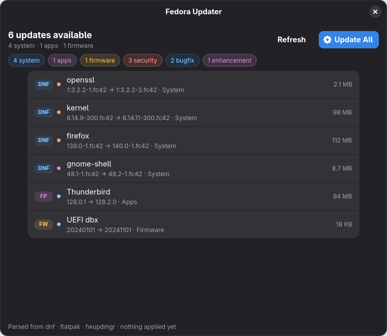
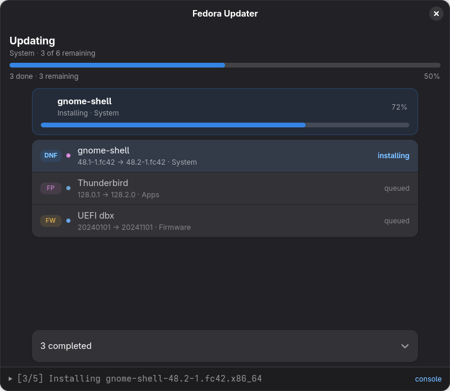
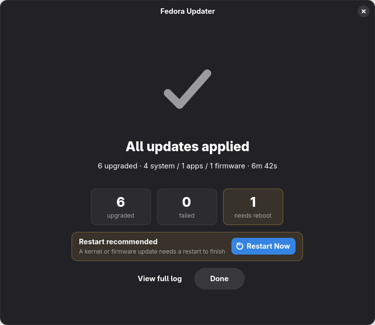

# Fedora Updater

A polished GNOME desktop front-end for **system (DNF)**, **Flatpak**, and **firmware (fwupd)** updates on Fedora.

| Review | Apply | Finish |
|:---:|:---:|:---:|
| [](screenshots/ready.png) | [](screenshots/running.png) | [](screenshots/done.png) |

This app is a **view layer on top of the system tools**. It never links against libdnf. Flatpak *discovery* uses libflatpak's `list_installed_refs_for_update` (the same call GNOME Software uses), so a runtime whose commit is current still shows up when a related extension such as the NVIDIA driver needs installing. Every host change still goes through a CLI tool:

| Area | Check | Apply |
|------|--------|--------|
| System | `dnf check-update --refresh` | `dnf update -y` |
| Flatpak (user) | libflatpak `list_installed_refs_for_update` | `flatpak update --user -y --noninteractive` |
| Flatpak (system) | libflatpak `list_installed_refs_for_update` | `flatpak update --system -y --noninteractive` |
| Firmware | `fwupdmgr refresh` + `get-updates` | `fwupdmgr update -y --no-reboot-check` |
| Reboot | — | `systemctl reboot` |

## Single multi-call binary

One executable does everything:

```text
fedora-updater           → GNOME GUI (unprivileged)
fedora-updater --helper  → allowlisted privileged helper (via pkexec)
```

The GUI elevates with:

```bash
pkexec /path/to/fedora-updater --helper
```

You can copy **`./bin/fedora-updater` alone** anywhere and run it. No second companion file.

### Single polkit prompt (per app run)

1. Polkit policy `dev.fedora.Updater.helper` uses **`auth_admin_keep`** for active sessions.
2. Helper mode stays open for the **whole GUI lifetime** (every Check and Apply reuses the same elevated process). It only exits when you close the window.
3. Helper only runs fixed allowlisted argv lists; the GUI never sees your password.

Optional system install:

```bash
./scripts/install-helper.sh
# installs /usr/bin/fedora-updater + polkit policy
```

Dev / test without polkit:

```bash
export FEDORA_UPDATER_HELPER_DIRECT=1   # run --helper without pkexec
# optional path override (still multi-call; --helper is appended):
export FEDORA_UPDATER_HELPER=/path/to/fedora-updater
```

## Features

- **Check → review → Update All**
- Sequential backends: **DNF → Flatpak user → Flatpak system → Firmware**
- Source badges on every row (DNF / FP / FW); severity chips when advisory kind is known
- Determinate check/apply progress with remaining-work text and incoming package list
- Expandable console (one live line when collapsed)
- Idle title matches check state; Failed is a StatusPage with Retry
- **Restart Now** via `systemctl reboot` (only when a reboot is required)
- One suggested-action per view · GNOME / libadwaita system styling

## Build & run

```bash
sudo dnf install gtk4-devel libadwaita-devel gcc pkgconf-pkg-config blueprint-compiler
# or: pip install --user blueprint-compiler

# Release build → single file under ./bin/
./build

# Run:
./bin/fedora-updater
```

## Architecture

```
fedora-updater (GUI)
       │
       ├── privilege session ── pkexec ──► fedora-updater --helper
       │                                      └── allowlisted dnf/fwupd/flatpak-system
       └── local commands ─────────────────── flatpak check via libflatpak, apply via flatpak(1)

state.rs                Pure state machine (heavily tested)
backend/*               dnf/fwupd parsers, flatpak libflatpak check + stdout progress
orchestrator.rs         Sequential check/apply pipelines
helper_protocol.rs      RUN <id> / __END__ <code> wire format
helper_mode.rs          Privileged allowlist implementation
src/ui/*.blp            Declarative Adwaita layout (Blueprint → GtkBuilder)
src/ui/window.rs        Bind + render over the state machine
```

## Tests

```bash
cargo test
```

## License

Apache-2.0
